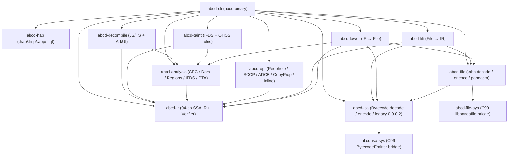

# Architecture Overview

`abcd-rs` is a pure-Rust + minimal-FFI toolkit for inspecting, disassembling, assembling, optimizing, rewriting, analyzing, and decompiling OpenHarmony / HarmonyOS NEXT ArkCompiler (`.abc`) bytecode and application packages (`.hap`, `.hsp`, `.app`, `.hqf`).

---

## 1. Layered Workspace Architecture

The workspace comprises **13 crates** organized around a strict one-way dependency ring separating `.abc`/ISA container details from the semantic SSA IR:

### Crate Responsibilities

| Crate | Role |
| :--- | :--- |
| `abcd-isa-sys` | Pre-generated Rust/C++ ISA tables + `cc::Build` C99 bridge over upstream `BytecodeEmitter` and format-version tables |
| `abcd-isa` | Safe `Bytecode` enum, modern (`9.0.0.0`–`24.0.0.0`) decoder/encoder, legacy (`0.0.0.2`) decoder, and entity operand metadata |
| `abcd-file-sys` | Exception-guarded, span-clamped C99 bridge over vendored `libpandafile` reader/writer/debug/annotation classes |
| `abcd-file` | `.abc` `decode` & `encode`, lossless dual-bucket MUTF-8 `StringPool`, structural module/literal/annotation relocation, and `pandasm` `.pa` disassembler/assembler |
| `abcd-hap` | Pure-Rust, zero-C reader for `.hap`, `.hsp`, `.app`, and `.hqf` OpenHarmony packages |
| `abcd-ir` | Format-independent `94`-op SSA IR (`Module`, `Op`, `Effects`, `Ty`, `TryRegion`, `frame::FrameSlots`, `verify_module`) |
| `abcd-lift` | `File → Module` converter: entity resolution, literal trees, ES module records, Braun SSA construction, and exception CFG |
| `abcd-opt` | `Module → Module` SSA passes: `Peephole`, `Sccp`, `Adce` + `CfgSimplify`, `CopyProp`, and opt-in intra-module `inline` |
| `abcd-lower` | `Module → File` converter: chordal MCS register allocation, parallel-copy cycle breaking, `acc`-as-cache `isel`, RPO layout, IC-slot sync, and per-method `u16` entity compaction |
| `abcd-analysis` | Shared static analysis library: iterative CHK dominators, Euler dominance intervals, region structuring, monotone framework, IFDS solver, Rung `0`/`1`/`2` alias/PTA ladder, `CallGraph`, `ModuleLinkTable`, and `ohos_lifecycle` |
| `abcd-taint` | Access-path IFDS taint engine, builtin & callback-gap summary library, prototype family resolver, and `@ohos.*` / `@kit.*` security rule pack |
| `abcd-decompile` | Three-stage bytecode → JS/TS decompiler with async/generator folds, `--split-modules` tree recovery, and `--arkui` `@Component struct` sugar |
| `abcd-cli` | End-user `abcd` CLI (`extract`, `info`, `dis`, `asm`, `decompile`, `rewrite`, `analyze`, `taint`) |

---

## 2. Primary Data-Flow Pipelines

- **Inspection & Extraction**: `.hap/.hsp/.app` → `abcd-hap` → `.abc` → `abcd-file::decode` → `abcd info`
- **Pandasm Round-Trip**: `.abc` → `abcd-file::decode` → `pandasm::emit_file` (`abcd dis`, byte-identical to `ark_disasm`) → `pandasm::parse_file` + `abcd-file::encode` (`abcd asm`)
- **Bytecode Rewriting**: `.abc` → `abcd-file::decode` → `abcd-lift::lift_file` → `abcd-ir::verify_module` → `[abcd-opt::optimize_module]` → `abcd-lower::rewrite_file` → `abcd-file::encode` (`abcd rewrite`)
- **Static & Taint Analysis**: `.abc` / `.hap` → `decode` → `lift_file` → `[merge_ir_modules + synthesize_ohos_harness]` → `abcd-analysis` / `abcd-taint::run_taint` (`abcd analyze`, `abcd taint`)
- **Decompilation**: `.abc` / `.hap` → `decode` → `lift_file` → `abcd-decompile::{decompile_module, decompile_module_split}` (`abcd decompile [--ts] [--split-modules] [--arkui]`)

---

## 3. Supported Bytecode Format Versions

| Format Version | SDK / Origin | Status in `abcd-rs` |
| :--- | :--- | :--- |
| `0.0.0.2` | OpenHarmony 3.2 / 4.0 pre-freeze (`ecma.*` prefixed ISA) | **Supported (Read / Lift / Analyze / Taint / Decompile)** via `abcd-isa::decode_legacy` + `abcd-lift`; raw `0.0.0.2` binary emission is unsupported by upstream `libpandafile` writer |
| `9.0.0.0` | API 9 (HarmonyOS 3.1 / OpenHarmony 3.2 Release) | **Full Support** (`decode`, `encode`, `dis`, `asm`, `lift`, `opt`, `lower`, `decompile`, `analyze`, `taint`) |
| `11.0.2.0` | API 11 (HarmonyOS 4.x / OpenHarmony 4.1) | **Full Support** |
| `12.0.2.0` / `12.0.6.0` | API 12 (HarmonyOS NEXT 5.0 / OpenHarmony 5.0) | **Full Support** (including `20+ MB` commercial `--merge-abc` bundles) |
| `13.0.1.0` | API 13 (OpenHarmony 5.1) | **Full Support** |
| `24.0.0.0` | API 14–24 (`OpenHarmony-v7.0-Release` pin) | **Full Support** |
| `0.1.0.7` (`STATIC`) | ArkTS 1.2 (`ets2panda` statically typed bytecode) | **Planned (`#36`)** — static ISA/container decoding, static IR calling convention (`H = 0`) & typed ops, analysis, and decompilation |
